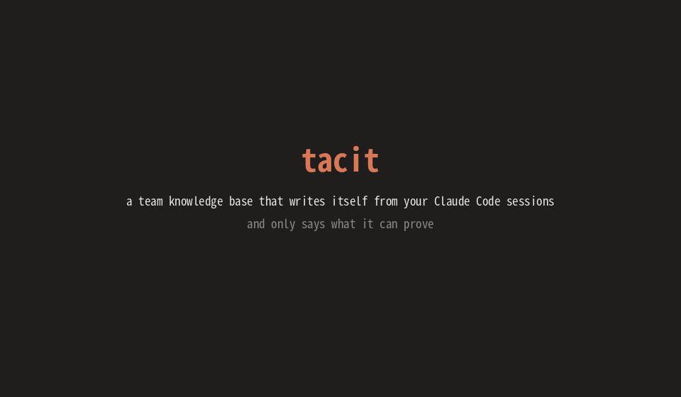

# tacit

> A team knowledge base that writes itself from your Claude Code sessions, and only says what it can prove.

📖 **Tech guide:** https://kannch8765.github.io/tacit/

Teams make decisions in chat with their coding agent every day: *"we pin pydantic < 3 because v3 breaks our
validators"*, *"staging deploys need the VPN"*. Those live in transcripts nobody re-reads. tacit watches your Claude
Code sessions in the background, keeps that knowledge as typed, versioned **cards**, and hands the relevant ones back
to the next prompt, each one with the exact words it came from.



```
 Claude Code                        tacit (local, SQLite)
 ───────────                        ─────────────────────
 Stop hook ───── queue session ───▶ worker (detached, one at a time)
                                      │  transcript → evidence events (secrets redacted)
                                      ▼
                                    observer turn ── any OpenAI-compatible model, tool calls only
                                      │  search · propose_<bucket> · reinforce · suggest_link
                                      │  decline_intent · deliver_whisper
                                      ▼
                                    ledger ── cards (versioned) · evidence · links
                                      │       batches · attempts · outcomes · intents · reviews
           ┌──────────────────────────┼─────────────────────────┐
           ▼                          ▼                         ▼
 UserPromptSubmit ◀── whispers    tacit review              tacit stats / health / report
   (queued + fast lane, no LLM)   (human inbox)             (numbers only)
```

## What makes it trustworthy

- **Grounded by reference.** Every text block, tool call and tool result in a batch gets a backend-owned
  `evidence_id`. The observer can only *cite* those ids; tacit copies the quote from the transcript itself. A card
  whose ids don't resolve is rejected with a reason code. It is never silently saved.
- **Buckets with rules in code.** `preference`, `workflow_habit`, `world_update`, `decision`, `gotcha`, each with
  required fields checked in code; reinforcing or replacing a card is an explicit observer call. A `world_update`
  (a knowledge-cutoff patch, like "the PM is now Mika") must be grounded by the user or a tool result, never by the
  assistant.
- **Nothing is edited in place.** Cards are versioned (SCD type 2): superseding closes the old version and links the
  new one, so "what do we believe now?" and "what did we believe on 10-10?" are both plain queries. Seeing the same
  knowledge again **reinforces** the card instead of duplicating it.
- **Grounded whispers.** The observer may whisper only a card its own search returned in this turn, and only 1-3 of
  that card's real snippets. tacit renders the text: date, version, the exact quotes, what the card replaced, linked
  cards (contradictions first, marked ⚠). A fast lane adds clear full-text matches on every prompt, with no model call.
- **Batches fail only for work they own.** Tool errors are feedback to the model, never a verdict. A batch is held
  (and the transcript cursor stays put) while owned work is unsettled: a failed turn, a storage failure, or a
  "remember that …" the observer hasn't answered yet (held for at most 3 completed turns). Retries are
  idempotent, so they converge instead of duplicating.
- **Privacy by default.** The ledger is a local SQLite file. The model you configure receives the batch's evidence
  and the cards its searches return, after redaction. Redaction is pattern-based: known token shapes, `KEY=value`
  assignments, credentials in URLs, private keys and sensitive field names in tool input are scrubbed from each whole
  block before anything is stored or sent. It lowers the risk; it can't promise every secret is caught. `stats`,
  `health` and `report` output numbers and fixed labels only, never card text.

## Use it

Requires Python 3.12+ and [uv](https://docs.astral.sh/uv/).

```sh
uv tool install .            # puts `tacit` on your PATH
export TACIT_LLM_MODEL=deepseek-v4-flash          # any model behind an OpenAI-compatible endpoint
export TACIT_LLM_API_KEY_FILE=~/.config/tacit/key # or TACIT_LLM_API_KEY
# optional: TACIT_LLM_BASE_URL (default https://opencode.ai/zen/v1), TACIT_HOME (default ~/.tacit)
```

Add the hooks to Claude Code (`~/.claude/settings.json`, or install this repo as a plugin; see
[`hooks/hooks.json`](hooks/hooks.json)):

```json
{
  "hooks": {
    "Stop": [{"hooks": [{"type": "command", "command": "tacit hook stop", "timeout": 10}]}],
    "UserPromptSubmit": [{"hooks": [{"type": "command", "command": "tacit hook prompt", "timeout": 10}]}]
  }
}
```

| Command | What it does |
|---|---|
| `tacit search <words>` | current cards, best match first (works for Japanese/Chinese too) |
| `tacit show <card>` / `tacit history <card>` | one card with its evidence and links / every version of it |
| `tacit review` | pending link suggestions; `tacit review accept\|dismiss <id>` decides one |
| `tacit stats [--days N]` | daily numbers as JSON |
| `tacit health` | ok / warn / alert per check, exit code 0 / 1 / 2 |
| `tacit report [--out DIR]` | a self-contained `report.html` with charts, plus `metrics.json` |
| `tacit worker` | drain queued and held batches by hand (the next Stop hook normally does it) |

## Develop

```sh
uv sync
uv run pytest      # 100+ tests; a scripted fake model, no network, no tokens
```

The design and its decisions are in [docs/DESIGN.md](docs/DESIGN.md).

## Status

v0.1. Tested end to end against a scripted model, and smoke-tested live on made-up sessions
([demo/](demo/), Gemini flash-lite through its OpenAI-compatible endpoint, no code changes). Not yet used on real
team sessions. Not in v0.1: embeddings, a web UI, team sync, editing CLAUDE.md.

## Credits

- Inspired by [letta-ai/claude-subconscious](https://github.com/letta-ai/claude-subconscious) (MIT): the hook-driven
  "background agent that whispers" idea. tacit is a separate rewrite with no shared code, no Letta dependency and a
  different focus (grounded team knowledge).
- Co-authored with Claude Opus 5.5 and GPT 6.1 Sol.

MIT licensed. Not affiliated with Anthropic. Claude, Claude Code and Clawd are trademarks of Anthropic.
